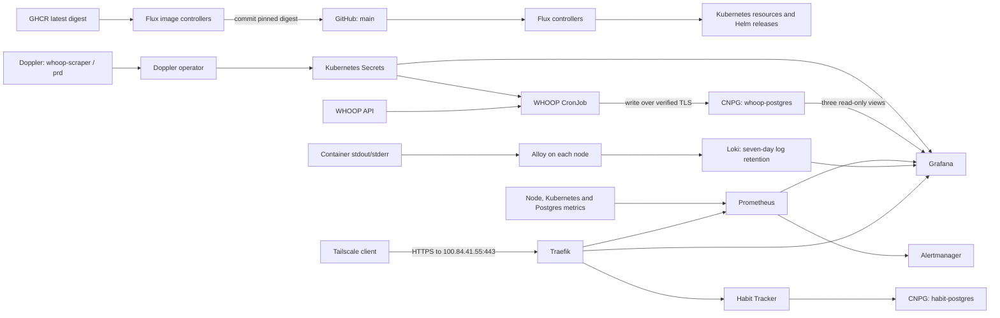

# homelab-flux

GitOps configuration for **forge**, a single-node k3s homelab. Flux reconciles this repository into the cluster. Monitoring and Habit Tracker are private over Tailscale. WHOOP data is collected daily into PostgreSQL and visualized in Grafana; Habit Tracker uses its own namespace and PostgreSQL instance.

This README describes the configuration in Git. Host installation, Tailscale enrollment, Cloudflare application DNS records, and database contents are managed outside this repository.

## Cluster at a glance

| Item | Configuration |
| --- | --- |
| Node | `forge`, single k3s control-plane/workload node |
| LAN address | `192.168.1.20` |
| Tailscale address | `100.84.41.55` |
| Base domain | `thehutchery.com`, managed in Cloudflare |
| Git source | `whutchinson98/homelab-flux`, branch `main` |
| Flux entry point | [`clusters/forge`](clusters/forge) |
| Storage | k3s `local-path`, local to the node |
| HTTPS routing | k3s Traefik, bound to the Tailscale address |
| Certificates | cert-manager, Let's Encrypt, Cloudflare DNS-01 |
| Secrets | SOPS/age for bootstrap secrets; Doppler for application configuration |

### Services

Connect to Tailscale before opening these URLs.

| Service | URL |
| --- | --- |
| Grafana | [grafana.thehutchery.com](https://grafana.thehutchery.com) |
| WHOOP dashboard | [WHOOP Overview](https://grafana.thehutchery.com/d/whoop-overview/whoop-overview) |
| Habit Tracker | [habits.thehutchery.com](https://habits.thehutchery.com) |
| Prometheus | [prometheus.thehutchery.com](https://prometheus.thehutchery.com) |
| Traefik dashboard | [traefik.thehutchery.com/dashboard/](https://traefik.thehutchery.com/dashboard/) |

Grafana has its own login. The Prometheus and Traefik routes do not configure an additional authentication layer; access to their HTTPS listener depends on tailnet connectivity and Tailscale policy.

## Architecture



### Repository layout

```text
clusters/forge/                    Flux orchestration and dependency ordering
  flux-system/                    Generated Flux controllers and Git sync
infrastructure/
  cert-manager/                   Certificate controller and ACME issuers
  cloudnative-pg/                  PostgreSQL operator
  databases/whoop/                Database, namespace and encrypted owner credentials
  doppler/                        Doppler Kubernetes operator
  monitoring/
    kube-prometheus-stack/        Prometheus, Grafana, Alertmanager and exporters
    loki/                         Log storage, retention and Grafana datasource
    alloy/                        Container log collection and delivery monitoring
    certificates/                 Grafana and Prometheus certificates
    routes/                       Private Grafana and Prometheus routes
    postgres/                     CNPG operator and database PodMonitors
    whoop/                        WHOOP dashboard and Doppler datasource sync
  networking/traefik/             k3s Traefik overrides and dashboard route
apps/whoop-scraper/
  secrets/                        Doppler token and environment/registry sync
  app/                            Scheduled scraper workload
apps/habit-tracker/                Private app, migration init container, image updates, secrets and certificate
scripts/                          Local setup and database helpers
.sops.yaml                        Encryption rules and public age recipient
```

Put shared controllers and cluster services under `infrastructure/`, workloads under `apps/`, and their Flux orchestration under `clusters/forge/`. A directory is deployed only when it is reachable through the Kustomize/Flux resource graph.

### Flux deployment order

The root `flux-system` Kustomization applies the child Flux Kustomizations. Their `dependsOn` declarations coordinate controllers, custom resources, secrets and workloads.

| Flux Kustomization | Direct dependencies |
| --- | --- |
| `monitoring` | None |
| `logging-loki` | `monitoring` |
| `logging-alloy` | `logging-loki` |
| `cert-manager` | None |
| `cert-manager-issuers` | `cert-manager` |
| `monitoring-certificates` | `cert-manager-issuers`, `monitoring` |
| `routing-traefik` | `cert-manager-issuers` |
| `monitoring-routes` | `routing-traefik`, `monitoring-certificates` |
| `cloudnative-pg` | None |
| `whoop-postgres` | `cloudnative-pg` |
| `postgres-monitoring` | `whoop-postgres`, `monitoring` |
| `doppler-operator` | None |
| `whoop-secrets` | `doppler-operator`, `whoop-postgres` |
| `whoop-scraper` | `whoop-secrets`, `whoop-postgres` |
| `whoop-grafana` | `monitoring`, `whoop-postgres`, `whoop-secrets` |
| `habit-postgres` | `cloudnative-pg` |
| `habit-tracker-secrets` | `doppler-operator`, `habit-postgres` |
| `habit-tracker-images` | `habit-tracker-secrets` |
| `habit-tracker-certificate` | `cert-manager-issuers`, `habit-postgres` |
| `habit-tracker` | `habit-postgres`, `habit-tracker-secrets`, `habit-tracker-certificate`, `routing-traefik` |
| `habit-postgres-monitoring` | `habit-postgres`, `monitoring` |

Flux checks Git every **minute**. Kustomizations also reconcile every **10 minutes**, and new source revisions trigger reconciliation automatically. Manual reconcile commands accelerate that process; they are not required for every push. Helm chart versions are pinned in each `HelmRelease`.

Most resources are pruned when removed from Git. The database Kustomization deliberately uses `prune: false` and `deletionPolicy: Orphan` to avoid automatically deleting the database and its namespace. This does not protect against disk failure or manual deletion.

## Networking and certificates

Cloudflare has manually maintained, **DNS-only** A records for `grafana`, `prometheus`, `traefik`, and `habits`, all pointing to `100.84.41.55`. Public DNS resolution does not make the Tailscale address publicly reachable.

Traefik uses host networking on `forge` and listens for application HTTPS only on `100.84.41.55:443`. The default web/websecure listeners, LoadBalancer Service and NodePorts are disabled. Its internal health/admin entry point binds to loopback. Routes use the `tailscale` entry point and ingress class annotation.

k3s owns the Traefik deployment. Flux owns its [`HelmChartConfig`](infrastructure/networking/traefik/helmchartconfig.yaml). The Tailscale interface must exist before Traefik can bind. Changing the node or Tailscale address requires updating the host configuration, chart overrides and DNS records together. Traefik runs as UID 0 with only `NET_BIND_SERVICE` retained so it can bind host port 443.

cert-manager uses Cloudflare DNS-01 challenges for Let's Encrypt certificates. No inbound public HTTP listener is needed for issuance. The Cloudflare API token is scoped to DNS write and zone read for `thehutchery.com`. Both staging and production issuers exist; current service certificates use `letsencrypt-prod`.

There is no cloudflared tunnel, public application ingress, or automatic application DNS record management configured here.

## Secrets and configuration

### SOPS and age

Encrypted `*.sops.yaml` files contain bootstrap/infrastructure credentials: the Cloudflare API token, Grafana admin credentials, PostgreSQL owner credentials, and WHOOP Doppler service token. The `data` and `stringData` fields are encrypted according to [`.sops.yaml`](.sops.yaml).

The public age recipient can live in Git. The private key belongs in a secure local backup and in the Kubernetes Secret **`flux-system/sops-age`**, with key **`age.agekey`**. Child Flux Kustomizations that consume encrypted manifests explicitly reference that Secret.

To edit an existing encrypted secret locally:

```bash
export SOPS_AGE_KEY_FILE="$HOME/.config/sops/age/homelab-flux.agekey"
sops infrastructure/cert-manager/issuers/cloudflare-api-token.sops.yaml
```

Commit the resulting encrypted file. Never commit the private age key, decrypted secret files, or raw tokens. The ignore rules help prevent accidents, but review staged changes before committing.

### Doppler

The operator reads **`whoop-scraper/prd`** and **`habit-tracker/prd`**, each using its own SOPS-protected read-only service token. It syncs every **60 seconds**.

| Doppler keys | Kubernetes Secret | Consumer |
| --- | --- | --- |
| `DATABASE_URL`, `WHOOP_CLIENT_ID`, `WHOOP_CLIENT_SECRET`, `WHOOP_TIMEZONE` | `whoop/whoop-scraper-env` | Scraper environment |
| `GHCR_DOCKERCONFIG` | `whoop/ghcr-auth` | Private GHCR image pulls |
| `WHOOP_GRAFANA_DATASOURCE` | `monitoring/grafana-whoop-datasource` | Grafana PostgreSQL datasource |

The Grafana `DopplerSecret` lives in `doppler-operator-system` so it can reference the token in `whoop` and create the datasource Secret in `monitoring`. Application environment sync explicitly selects its four keys, keeping registry and Grafana credentials out of that environment Secret.

Edit application values in Doppler. New CronJob pods read the updated environment; running pods retain their existing environment. Grafana's sidecar reloads datasource provisioning when its Secret changes. Do not manually edit operator-managed Secrets.

Local helpers that publish values need a Doppler CLI login with **write access** to this config. The operator's read-only service token is for fetching values. `WHOOP_GRAFANA_DATASOURCE` contains a database password even though it looks like a provisioning document.

## Monitoring and storage

`kube-prometheus-stack` provides Prometheus, Grafana, Alertmanager, node-exporter and kube-state-metrics. Additional PodMonitors collect CNPG operator metrics and database metrics over TLS. Conventional etcd, scheduler, controller-manager and kube-proxy targets/rules are disabled in this k3s configuration.

| Persistent workload | Requested local-path capacity | Retention |
| --- | --- | --- |
| Prometheus | 50 GiB | 30 days, with a 40 GB size limit |
| Grafana | 1 GiB | Persistent Grafana state |
| Alertmanager | 1 GiB | Persistent Alertmanager state |
| Loki | 20 GiB | 7 days; compactor deletes expired logs asynchronously |
| WHOOP PostgreSQL | 10 GiB | No application retention policy configured here |
| Habit Tracker PostgreSQL | 10 GiB | Habit and completion history |

These volumes depend on the node's disk. `local-path` does not enforce the requested capacities or support online volume expansion in this setup. There is one database instance, no database HA, and no off-node backup configured in this repository.

Alert rules are active, but Alertmanager currently routes to a `null` receiver. **Notifications are not delivered yet.** Backup/recovery and an alert destination are the main remaining operational gaps.

### Centralized container logs

Alloy runs as a DaemonSet, discovers pods on its own node, and reads their containerd CRI logs from `/var/log/pods` through a read-only mount. It collects stdout/stderr across namespaces, including init containers and CronJobs. Services do not need OpenTelemetry or a logging SDK. Logs written only to application files, host journald logs, and Kubernetes Events are not collected by this pipeline.

Loki runs as one monolithic instance in `monitoring`, using TSDB/v13 indexes and local filesystem storage. Its PVC holds log chunks, indexes, the ingester WAL, and compactor state. The compactor enforces `168h` retention; deletion is asynchronous. The 20 GiB PVC request is **not a disk quota**, and Loki does not delete logs based on free space. Monitor node disk usage and adjust retention based on actual volume. Data is local to `forge`, with no replication or off-node backup.

Alloy persists file read positions in the node directory `/var/lib/alloy` so normal collector restarts do not reread every file. Delivery uses in-memory batching and bounded retries; this is not a guarantee of lossless delivery through collector crashes or prolonged Loki outages. `AlloyLogDeliveryFailed` detects entries discarded after retries, and `AlloyLogCollectorDown` detects an unavailable collector. Both components have ServiceMonitors; Loki also installs its chart's recording and alert rules. Alert notifications still require configuring an Alertmanager receiver.

Loki and Alloy have ClusterIP services without ingress. Loki's ingress NetworkPolicy permits only Alloy, Grafana, Prometheus, and Loki pods in `monitoring`; users query through Grafana's existing login. Alloy runs as root with all capabilities dropped to read node-owned logs, and its Kubernetes RBAC grants only pod discovery, without Secret access.

Open [Grafana Explore](https://grafana.thehutchery.com/explore), select **Loki**, and choose a time range. Example queries:

```logql
{cluster="forge", namespace="whoop", service_name="whoop-scraper"}
{namespace="habit-tracker"} |~ "(?i)error|warn"
{namespace="whoop"} | pod="whoop-scraper-example-pod"
```

Indexed labels are `cluster`, `namespace`, `service_name`, `container`, `node`, and CRI `stream`. `service_name` uses `app.kubernetes.io/name`, then `app`, then the container name. Pod names are stored as structured metadata: filter them after `|`, rather than inside `{...}`. JSON application logs can be parsed with `| json`; plain text remains searchable. Do not log credentials or tokens; this pipeline preserves application log contents.

Once Loki has ingested a log, deleting its Pod or Job does not remove the stored copy. Logs from pods deleted before collection cannot be recovered. Allow short-lived Jobs time to be discovered and ingested before deleting them.

Logging configuration is in `infrastructure/monitoring/loki/values.yaml` and `infrastructure/monitoring/alloy/config.alloy`. Flux deploys Loki after monitoring and Alloy after Loki. Chart versions are pinned, and the Grafana datasource is provisioned by its existing sidecar. Loki PVCs are retained when its StatefulSet is deleted or scaled down; deliberately deleting a PVC can still destroy log data.

## WHOOP data pipeline

The [`whoop-scraper` CronJob](apps/whoop-scraper/app/cronjob.yaml) runs at **09:00 America/Toronto** every day. It uses the private image `ghcr.io/whutchinson98/whoop-scraper:latest` with `imagePullPolicy: Always`: each new pod resolves the current image. Image updates do not require a Git commit, and the running image is not pinned to a digest here.

Scheduled runs do not overlap (`concurrencyPolicy: Forbid`). A run has a 30-minute deadline, a 10-minute missed-start allowance, and no automatic Job retries because WHOOP OAuth refresh-token rotation can have an ambiguous outcome after a failure. Three successful and three failed Jobs are retained.

The scraper connects to database `whoop` at `whoop-postgres-rw.whoop.svc.cluster.local:5432`, using verified TLS and the CNPG public CA. PostgreSQL rejects non-TLS host connections. The scraper applies its embedded SQLx migrations; the OAuth refresh token is stored in PostgreSQL. The schedule timezone and `WHOOP_TIMEZONE` reporting setting are separate configurations.

Grafana uses a dedicated `whoop_grafana` login with SELECT access to only:

- `public.whoop_cycle_metrics`
- `public.whoop_cycle_metric_values`
- `public.whoop_weight_observations`

It cannot read the token/source tables or write application data. The [reader grants](scripts/whoop-grafana-reader.sql) are applied by the local setup helper, rather than by Flux.

The [WHOOP dashboard JSON](infrastructure/monitoring/whoop/whoop-overview.json) is provisioned from a labeled ConfigMap; edit it in Git for persistent changes. It refreshes every five minutes and defaults to a 30-day display window. Cycle metrics remain per physiological cycle, missing values remain gaps, and weight uses its actual observation time. Quality panels identify incomplete cycles. Refreshing Grafana does not trigger a scrape or import older history.

## Habit Tracker and automatic image updates

[Habit Tracker](https://github.com/whutchinson98/habit-tracker) runs in namespace `habit-tracker`, with database `habits` owned by `habit` on CNPG cluster `habit-postgres`. The database has one instance on `forge`, local-path storage, verified TLS and no public database Service. Its Flux Kustomization preserves resources on removal, just like WHOOP's database. Credentials are encrypted in [credentials.sops.yaml](infrastructure/databases/habit-tracker/credentials.sops.yaml).

Doppler `habit-tracker/prd` supplies `DATABASE_URL` and `APP_TIMEZONE=America/Toronto` to `habit-tracker-env`, and `GHCR_DOCKERCONFIG` to `ghcr-auth`. The registry credential is available to both pod pulls and Flux's image reflector. The app has no login; anyone permitted to reach its HTTPS listener through the tailnet can use it.

Flux's image-reflector and image-automation controllers are included in the generated bootstrap manifest. The [image policy](apps/habit-tracker/images/policy.yaml) selects only `latest` and checks its digest every minute. The automation checks every five minutes and commits digest changes to `main` using the existing writable Flux deploy key. SHA tags are not sorted chronologically; the digest of tested `latest` is the update signal.

One digest setter in [app/kustomization.yaml](apps/habit-tracker/app/kustomization.yaml) pins both the migration init container and app. A single-replica `Recreate` deployment stops the old pod, runs `bun src/server/db/migrate.ts`, and starts the new app only after migrations succeed. This initializes a fresh database and runs pending migrations on later rollouts. Expect brief downtime during updates. Do not scale this deployment above one replica or run migrations concurrently. Application rollback does not roll back database migrations.

The connection uses `sslmode=verify-full` and `NODE_EXTRA_CA_CERTS=/etc/postgresql/ca/ca.crt`. Only the public CA certificate is mounted. Startup/liveness checks use `/api/health/live`; readiness checks PostgreSQL through `/api/health/ready`.

After pushing these manifests, Flux can bring up the dependency chain automatically. To follow the initial deployment explicitly:

```bash
flux reconcile kustomization flux-system --with-source
kubectl -n flux-system rollout status deployment/image-reflector-controller --timeout=5m
kubectl -n flux-system rollout status deployment/image-automation-controller --timeout=5m
flux reconcile kustomization habit-postgres --with-source
flux reconcile kustomization habit-tracker-secrets --with-source
flux reconcile kustomization habit-tracker-certificate --with-source
flux reconcile kustomization habit-tracker-images --with-source
flux reconcile kustomization habit-tracker --with-source
kubectl -n habit-tracker rollout status deployment/habit-tracker --timeout=10m
kubectl -n habit-tracker logs deployment/habit-tracker -c migrate
flux get images all -n habit-tracker
```

For a migration failure, inspect init-container logs and fix the migration before retrying; do not bypass initialization. For image update failures, inspect `flux logs --kind=ImageUpdateAutomation --name=habit-tracker --namespace=habit-tracker --level=error`. Flux needs a deploy key allowed to write to this repository and a `main` branch policy that permits its commits.

To hold a particular version, set `spec.suspend: true` on the [ImageUpdateAutomation](apps/habit-tracker/images/automation.yaml), pin the desired digest, and push both changes together. For normal manual Git changes, pull before editing/pushing because Flux also commits to `main`.

## Common operations

Run these from a workstation with the intended Kubernetes context. Routine tools are `kubectl`, `flux`, Git, and Python 3; secret maintenance also uses `sops`, age and the Doppler CLI.

### Check cluster and reconciliation status

```bash
kubectl config current-context
kubectl get nodes -o wide
flux get sources git -A
flux get kustomizations -A
flux get helmreleases -A
kubectl get certificates -A
kubectl get pods -A
```

### Make and deploy a change

Edit manifests, inspect the diff, and build the affected Kustomize directory. For example:

```bash
kubectl kustomize infrastructure/monitoring/whoop > /dev/null
kubectl kustomize clusters/forge > /dev/null
git diff --check
git diff
git add infrastructure/monitoring/whoop/whoop-overview.json
git commit -m "Describe the change"
git push
```

Building `clusters/forge` checks the orchestration manifests; it does not recursively build each child Flux Kustomization's target directory. Build each changed target as well. These local builds do not prove runtime readiness.

Wait for automatic reconciliation, or accelerate it:

```bash
flux reconcile kustomization flux-system --with-source
flux reconcile kustomization whoop-grafana --with-source
```

Replace `whoop-grafana` with the affected child from the dependency table. A successful root reconciliation alone does not mean every child Helm release or workload is healthy. Live edits to Git-managed resources may be reverted by Flux; make lasting changes in Git.

### Check or run the scraper

```bash
kubectl -n whoop get cronjob whoop-scraper
kubectl -n whoop get jobs --sort-by=.metadata.creationTimestamp
kubectl -n whoop get pods -l app.kubernetes.io/name=whoop-scraper
```

For an intentional extra run, first check that no scraper Job is active. The CronJob concurrency policy does not coordinate manually created Jobs:

```bash
whoop_job="whoop-scraper-manual-$(date +%s)"
kubectl -n whoop create job "$whoop_job" --from=cronjob/whoop-scraper
kubectl -n whoop logs -f "job/$whoop_job" --pod-running-timeout=5m
kubectl -n whoop wait --for=condition=complete "job/$whoop_job" --timeout=30m
```

For a durable schedule pause, set `spec.suspend: true` in the CronJob manifest and push it. Suspending a CronJob does not stop a Job already running.

### Access PostgreSQL locally

In one terminal, keep this loopback-only tunnel running:

```bash
kubectl -n whoop port-forward --address localhost service/whoop-postgres-rw 55434:5432
```

In another terminal, from the sibling scraper checkout, use the helper to supply a local `DATABASE_URL` and temporary public CA certificate to a tool that reads that environment variable:

```bash
cd ~/d/whoop-scraper
python3 ../homelab-flux/scripts/whoop-db.py local -- sqlx migrate info
```

This example requires the SQLx CLI. The helper uses the application owner credentials and full TLS verification; the database certificate includes `localhost`. It preserves the caller's working directory. Avoid wrapping the child command in another environment loader that overwrites the helper's local `DATABASE_URL` with Doppler's cluster-only URL.

### Setup and credential helpers

Run from the root of this repository unless noted otherwise.

| Command | Purpose |
| --- | --- |
| `python3 scripts/whoop-db.py publish-url` | Publish the existing cluster owner connection URL to Doppler |
| `python3 scripts/configure-whoop-ghcr.py` | Store GHCR pull credentials in Doppler; prompts for a GitHub token |
| `python3 scripts/configure-whoop-grafana.py` | Create/update the restricted reader and publish its TLS datasource to Doppler |
| `python3 scripts/configure-cloudflare.py` | Initial encrypted Cloudflare token creation; refuses to overwrite an existing file |
| `python3 scripts/configure-whoop-doppler.py` | Original one-time Doppler token/bootstrap setup; not a routine rerun or rotation command |

Rerun the Grafana helper after restoring the database or replacing its CA. It reuses the password already stored in Doppler. For existing SOPS-protected token files, use `sops <path>` to edit them and push the encrypted change. Republishing a database URL does not itself rotate the PostgreSQL password.

### Troubleshooting

| Symptom | Start here |
| --- | --- |
| Flux cannot clone GitHub | `flux logs --kind=GitRepository --name=flux-system --level=error`; check the repository deploy key. Workstation SSH credentials and Flux's deploy key are separate. |
| `sops-age` missing / decryption failure | Check `kubectl -n flux-system get secret sops-age` and that its private key matches the recipient in `.sops.yaml`. |
| A child is waiting on a dependency | `flux get kustomizations -A`; inspect the earliest failing dependency before downstream workloads. |
| Certificate remains unready | `kubectl get certificaterequests,orders,challenges -A`; check the Cloudflare token and issuer. |
| Private URLs fail | Check Tailscale connectivity, DNS-only records, and `kubectl -n kube-system logs deployment/traefik --tail=80`. |
| Doppler values are not syncing | `kubectl get dopplersecrets -A`; describe the affected resource and inspect its conditions. |
| `ImagePullBackOff` | Describe the scraper pod; check `whoop/ghcr-auth` exists and the GHCR token can read the private package. |
| WHOOP dashboard has no data | Check the selected account/time range, recent scraper Job logs, and the WHOOP PostgreSQL datasource in Grafana. |
| Grafana Explore has no logs | Select Loki and widen the time range; check `flux get kustomizations -A`, `kubectl -n monitoring get pods -l app.kubernetes.io/name=alloy`, and `kubectl -n monitoring logs statefulset/loki --tail=80`. |
| Alloy cannot deliver logs | Check `kubectl -n monitoring logs daemonset/alloy -c alloy --tail=80`, Loki readiness, node disk space, and `AlloyLogDeliveryFailed` in Prometheus. |

## Bootstrap and recovery boundaries

A replacement cluster needs host-level preparation first: k3s, a reachable kubeconfig, the expected `forge` node name, local storage, and Tailscale enrollment/address. Those steps are not automated here.

The Flux bootstrap target is:

```bash
flux bootstrap git \
  --url=ssh://git@github.com/whutchinson98/homelab-flux.git \
  --branch=main \
  --components-extra=image-reflector-controller,image-automation-controller \
  --path=clusters/forge
```

Register the cluster's public SSH deploy key with the GitHub repository when prompted. Restore the existing private age key from secure backup and install it once the `flux-system` namespace exists:

```bash
kubectl -n flux-system create secret generic sops-age \
  --from-file=age.agekey="$HOME/.config/sops/age/homelab-flux.agekey" \
  --dry-run=client -o yaml | kubectl apply -f -
```

This passes key material directly to Kubernetes; do not save or commit the generated Secret manifest. Reconcile and inspect the dependency graph after the key is available.

Git can recreate Kubernetes configuration, but it cannot recreate PostgreSQL data, WHOOP OAuth state, Grafana's persisted state, or Prometheus history. Doppler values and external credentials must still be available. There is currently no tested, automated data-restoration workflow in this repo. A replacement database initialized from these manifests starts empty unless data is restored separately; initialize its migrations/OAuth state and Grafana reader before expecting the application pipeline to work.
